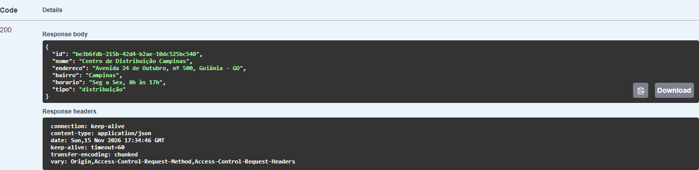
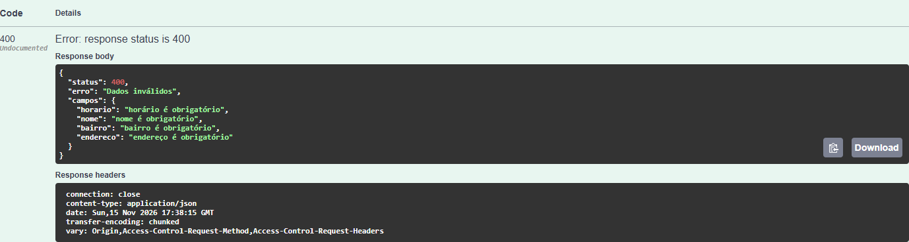
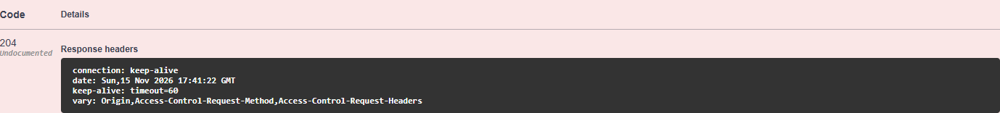

# Instituto Mão Amiga API

API Spring Boot da issue **N2-1**: CRUD de pontos de coleta e distribuição, com banco H2 em arquivo.

## Como rodar

Requisitos: Java 17 ou superior.

Na raiz do projeto:

```bash
mvnw.cmd spring-boot:run
```

A API sobe em `http://localhost:8080`.

- Swagger UI: http://localhost:8080/swagger-ui.html
- Console do H2: http://localhost:8080/h2-console
  - JDBC URL: `jdbc:h2:file:./data/maoamiga`
  - usuário: `sa`
  - senha: em branco

O banco fica no arquivo `data/maoamiga`. A carga inicial grava 10 pontos de Goiânia somente quando a tabela está vazia. Reiniciar a API não duplica esses registros.

## Endpoints

| Método | URL | Sucesso |
| --- | --- | --- |
| GET | http://localhost:8080/api/v1/pontos | 200, lista de pontos |
| GET | http://localhost:8080/api/v1/pontos/{id} | 200, um ponto. Id inexistente: 404 |
| POST | http://localhost:8080/api/v1/pontos | 201, ponto criado |
| PUT | http://localhost:8080/api/v1/pontos/{id} | 200, ponto atualizado. Id inexistente: 404 |
| DELETE | http://localhost:8080/api/v1/pontos/{id} | 204, sem corpo |

`@CrossOrigin` está liberado no controller.

Corpo do POST e do PUT:

```json
{
  "nome": "Ponto Setor Oeste",
  "endereco": "Rua 10, nº 20, Goiânia - GO",
  "bairro": "Setor Oeste",
  "horario": "Seg a Sex, 8h às 17h",
  "tipo": "coleta"
}
```

`nome`, `endereco`, `bairro`, `horario` e `tipo` são obrigatórios e não podem ser vazios. `tipo` aceita somente `coleta` ou `distribuição`. Campo vazio ou ausente responde **400** e não grava nada.

A resposta de sucesso é um `PontoResponseDTO`, nunca a entidade:

```json
{
  "id": "uuid",
  "nome": "Ponto Setor Oeste",
  "endereco": "Rua 10, nº 20, Goiânia - GO",
  "bairro": "Setor Oeste",
  "horario": "Seg a Sex, 8h às 17h",
  "tipo": "coleta"
}
```

## Swagger

### GET /api/v1/pontos — 200


### GET /api/v1/pontos/{id} — 200



### GET /api/v1/pontos/{id} — 404


### POST /api/v1/pontos — 201


### POST /api/v1/pontos — 400



### PUT /api/v1/pontos/{id} — 200


### PUT /api/v1/pontos/{id} — 404


### DELETE /api/v1/pontos/{id} — 204

A exclusão responde sem corpo.


