# Instituto Mão Amiga API

API Spring Boot do Instituto Mão Amiga. A N2-1 entrega o CRUD de pontos, a N2-2 a busca paginada e a N2-5 o CRUD de doações.

## Como rodar

Requisitos: Java 17 ou superior.

Na raiz do projeto:

```bash
mvnw.cmd spring-boot:run
```

A API sobe em `http://localhost:8080`.

- Swagger UI: http://localhost:8080/swagger-ui.html
- Console do H2: http://localhost:8080/h2-console
  - JDBC URL: `jdbc:h2:file:./data/maoamiga`
  - usuário: `sa`
  - senha: em branco

O banco fica no arquivo `data/maoamiga`. A carga inicial grava 26 pontos de Goiânia e só insere os nomes que ainda não existem. Reiniciar a API não duplica esses registros.

## Endpoints

| Método | URL | Sucesso |
| --- | --- | --- |
| GET | http://localhost:8080/api/v1/pontos | 200, lista de pontos |
| GET | http://localhost:8080/api/v1/pontos/filtro?filtro=&page=0&size=10 | 200, página de pontos. Sem `filtro`, devolve todos. Padrão: 10 itens, ordenados por nome |
| GET | http://localhost:8080/api/v1/pontos/{id} | 200, um ponto. Id inexistente: 404 |
| POST | http://localhost:8080/api/v1/pontos | 201, ponto criado |
| PUT | http://localhost:8080/api/v1/pontos/{id} | 200, ponto atualizado. Id inexistente: 404 |
| DELETE | http://localhost:8080/api/v1/pontos/{id} | 204, sem corpo |

`@CrossOrigin` está liberado no controller.

Corpo do POST e do PUT:

```json
{
  "nome": "Ponto Setor Oeste",
  "endereco": "Rua 10, nº 20, Goiânia - GO",
  "bairro": "Setor Oeste",
  "horario": "Seg a Sex, 8h às 17h",
  "tipo": "coleta"
}
```

`nome`, `endereco`, `bairro`, `horario` e `tipo` são obrigatórios e não podem ser vazios. `tipo` aceita somente `coleta` ou `distribuição`. Campo vazio ou ausente responde **400** e não grava nada.

A resposta de sucesso é um `PontoResponseDTO`, nunca a entidade:

```json
{
  "id": "uuid",
  "nome": "Ponto Setor Oeste",
  "endereco": "Rua 10, nº 20, Goiânia - GO",
  "bairro": "Setor Oeste",
  "horario": "Seg a Sex, 8h às 17h",
  "tipo": "coleta"
}
```

## Swagger

### GET /api/v1/pontos — 200

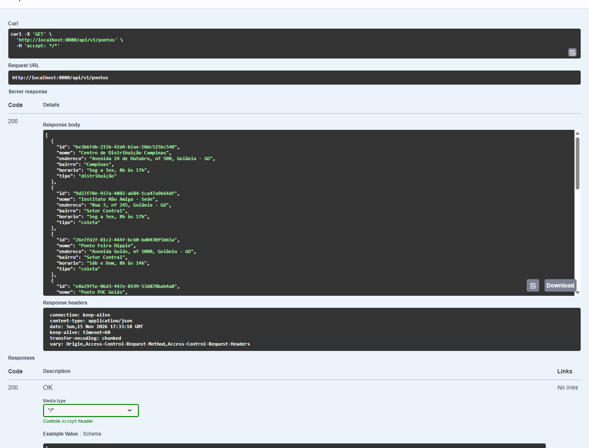

### GET /api/v1/pontos/{id} — 200


### GET /api/v1/pontos/{id} — 404

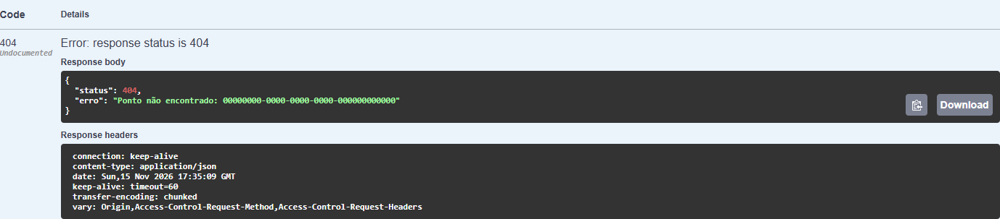

### POST /api/v1/pontos — 201

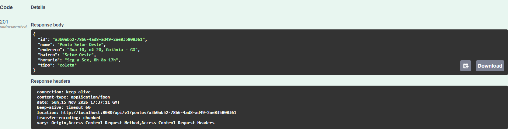

### POST /api/v1/pontos — 400


### PUT /api/v1/pontos/{id} — 200

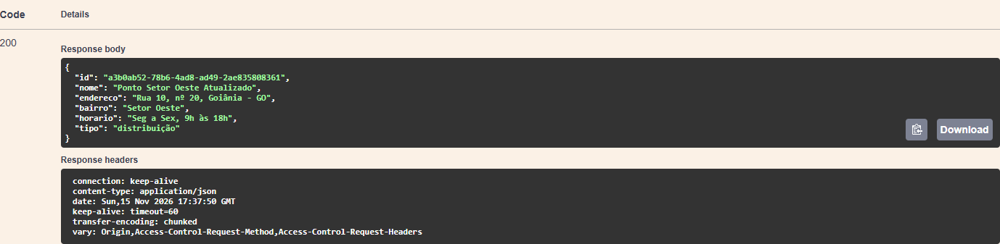

### PUT /api/v1/pontos/{id} — 404

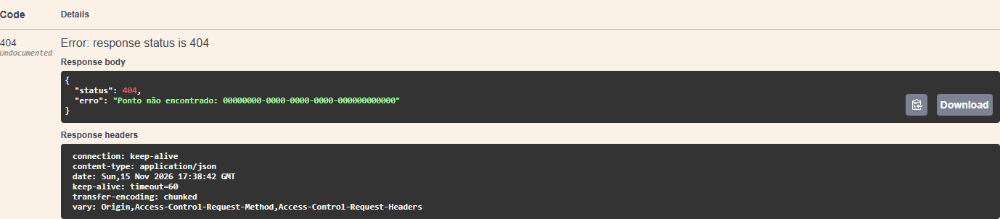

### DELETE /api/v1/pontos/{id} — 204

A exclusão responde sem corpo.


## Busca paginada

`GET /api/v1/pontos/filtro` devolve `content` e `page`. O filtro procura no nome ou no bairro, sem diferenciar maiúsculas. Sem `filtro`, a resposta traz todos os pontos paginados. O padrão é 10 itens ordenados por nome. `sort=bairro,asc` troca a ordem.

### Sem filtro

`GET http://localhost:8080/api/v1/pontos/filtro?page=0&size=10`

```json
{
  "content": [
    {
      "id": "be3b6fdb-215b-42d4-b2ae-10dc525bc540",
      "nome": "Centro de Distribuição Campinas",
      "endereco": "Avenida 24 de Outubro, nº 500, Goiânia - GO",
      "bairro": "Campinas",
      "horario": "Seg a Sex, 8h às 17h",
      "tipo": "distribuição"
    },
    {
      "id": "9d27f70e-937a-4802-a684-1ca47a9b64df",
      "nome": "Instituto Mão Amiga - Sede",
      "endereco": "Rua 3, nº 245, Goiânia - GO",
      "bairro": "Setor Central",
      "horario": "Seg a Sex, 8h às 17h",
      "tipo": "coleta"
    },
    {
      "id": "ca0d9775-68e3-48a8-b434-e4df38767854",
      "nome": "Ponto Assembleia Legislativa",
      "endereco": "Avenida Olinda, s/n, Goiânia - GO",
      "bairro": "Setor Pedro Ludovico",
      "horario": "Seg a Sex, 8h às 18h",
      "tipo": "coleta"
    },
    {
      "id": "db7adacc-8628-410b-9071-6fedea4343af",
      "nome": "Ponto Bosque dos Buritis",
      "endereco": "Avenida Assis Chateaubriand, s/n, Goiânia - GO",
      "bairro": "Setor Oeste",
      "horario": "Seg a Dom, 6h às 18h",
      "tipo": "coleta"
    },
    {
      "id": "d783910a-b892-46a3-94e4-57a1c246c094",
      "nome": "Ponto Cidade Jardim",
      "endereco": "Avenida C-107, nº 200, Goiânia - GO",
      "bairro": "Cidade Jardim",
      "horario": "Seg a Sex, 8h às 17h",
      "tipo": "coleta"
    },
    {
      "id": "26e7fd2f-81c2-444f-bc60-bd0430f5b61a",
      "nome": "Ponto Feira Hippie",
      "endereco": "Avenida Goiás, nº 1000, Goiânia - GO",
      "bairro": "Setor Central",
      "horario": "Sáb e Dom, 8h às 14h",
      "tipo": "coleta"
    },
    {
      "id": "ba152751-91b5-4901-baad-3788d9387119",
      "nome": "Ponto Hospital das Clínicas",
      "endereco": "Primeira Avenida, s/n, Goiânia - GO",
      "bairro": "Setor Leste Universitário",
      "horario": "Todos os dias, 24h",
      "tipo": "distribuição"
    },
    {
      "id": "ddcab1cf-a8c5-46f4-ab1b-887f165d7e3a",
      "nome": "Ponto Jardim América",
      "endereco": "Rua C-200, nº 40, Goiânia - GO",
      "bairro": "Jardim América",
      "horario": "Seg a Sex, 8h às 17h",
      "tipo": "distribuição"
    },
    {
      "id": "6f80eef5-fd30-4ba9-ac19-2b01d94fecf3",
      "nome": "Ponto Lago das Rosas",
      "endereco": "Rua 2, s/n, Goiânia - GO",
      "bairro": "Setor Oeste",
      "horario": "Seg a Sex, 8h às 17h",
      "tipo": "coleta"
    },
    {
      "id": "d518e817-cf97-4d24-939a-a3b95bf054cc",
      "nome": "Ponto Mercado Central",
      "endereco": "Avenida Paranaíba, s/n, Goiânia - GO",
      "bairro": "Setor Central",
      "horario": "Seg a Sáb, 7h às 18h",
      "tipo": "distribuição"
    }
  ],
  "page": {
    "size": 10,
    "number": 0,
    "totalElements": 26,
    "totalPages": 3
  }
}
```

### Filtrando por bairro

`GET http://localhost:8080/api/v1/pontos/filtro?filtro=bueno&page=0&size=10`

```json
{
  "content": [
    {
      "id": "4a3025a2-6102-427f-b985-ad7ec211de94",
      "nome": "Ponto Parque Vaca Brava",
      "endereco": "Avenida T-10, s/n, Goiânia - GO",
      "bairro": "Setor Bueno",
      "horario": "Seg a Sáb, 9h às 18h",
      "tipo": "coleta"
    },
    {
      "id": "3c2c3bdf-0620-47b4-bcfd-99d1c3460b0e",
      "nome": "Ponto Praça do Sol",
      "endereco": "Avenida T-63, s/n, Goiânia - GO",
      "bairro": "Setor Bueno",
      "horario": "Seg a Sáb, 8h às 18h",
      "tipo": "coleta"
    },
    {
      "id": "d13ad098-29f5-4cc0-8862-ffc0bd6fc9c1",
      "nome": "Ponto Shopping Bougainville",
      "endereco": "Avenida T-10, nº 1300, Goiânia - GO",
      "bairro": "Setor Bueno",
      "horario": "Seg a Sáb, 10h às 22h",
      "tipo": "distribuição"
    }
  ],
  "page": {
    "size": 10,
    "number": 0,
    "totalElements": 3,
    "totalPages": 1
  }
}
```

### Segunda página

`GET http://localhost:8080/api/v1/pontos/filtro?page=1&size=10`

```json
{
  "content": [
    {
      "id": "b93a655c-d718-4f10-9c0c-ca5159f7108a",
      "nome": "Ponto Mutirama",
      "endereco": "Avenida Contorno, s/n, Goiânia - GO",
      "bairro": "Setor Central",
      "horario": "Ter a Dom, 9h às 17h",
      "tipo": "coleta"
    },
    {
      "id": "85945934-937a-4bfa-8773-a5b2b46c3a44",
      "nome": "Ponto Oscar Niemeyer",
      "endereco": "Avenida Deputado Jamel Cecílio, s/n, Goiânia - GO",
      "bairro": "Jardim Goiás",
      "horario": "Ter a Dom, 9h às 18h",
      "tipo": "distribuição"
    },
    {
      "id": "e8a29f5e-06d3-447e-8199-53d878bab4a8",
      "nome": "Ponto PUC Goiás",
      "endereco": "Avenida Universitária, nº 1440, Goiânia - GO",
      "bairro": "Setor Universitário",
      "horario": "Seg a Sex, 8h às 20h",
      "tipo": "coleta"
    },
    {
      "id": "6fa72a26-a30c-4612-aef3-b1d69efe29f6",
      "nome": "Ponto Parque Areião",
      "endereco": "Avenida Ricardo Paranhos, s/n, Goiânia - GO",
      "bairro": "Setor Pedro Ludovico",
      "horario": "Ter a Sáb, 8h às 16h",
      "tipo": "distribuição"
    },
    {
      "id": "c17e977d-34ae-40e3-a77b-c10c1a1fdc85",
      "nome": "Ponto Parque Cascavel",
      "endereco": "Rua 90, s/n, Goiânia - GO",
      "bairro": "Setor Sul",
      "horario": "Seg a Dom, 8h às 18h",
      "tipo": "coleta"
    },
    {
      "id": "4a3025a2-6102-427f-b985-ad7ec211de94",
      "nome": "Ponto Parque Vaca Brava",
      "endereco": "Avenida T-10, s/n, Goiânia - GO",
      "bairro": "Setor Bueno",
      "horario": "Seg a Sáb, 9h às 18h",
      "tipo": "coleta"
    },
    {
      "id": "af331a2e-d06d-403f-97f4-9970b0e171bf",
      "nome": "Ponto Praça Cívica",
      "endereco": "Praça Cívica, s/n, Goiânia - GO",
      "bairro": "Setor Central",
      "horario": "Seg a Sex, 8h às 18h",
      "tipo": "coleta"
    },
    {
      "id": "3c2c3bdf-0620-47b4-bcfd-99d1c3460b0e",
      "nome": "Ponto Praça do Sol",
      "endereco": "Avenida T-63, s/n, Goiânia - GO",
      "bairro": "Setor Bueno",
      "horario": "Seg a Sáb, 8h às 18h",
      "tipo": "coleta"
    },
    {
      "id": "249845ba-50e4-48dc-a77b-28a783e029be",
      "nome": "Ponto Serra Dourada",
      "endereco": "Avenida Fued José Sebba, s/n, Goiânia - GO",
      "bairro": "Jardim Goiás",
      "horario": "Seg a Sex, 8h às 17h",
      "tipo": "coleta"
    },
    {
      "id": "214133bb-96cf-465e-b0e3-47cff6f2ffb0",
      "nome": "Ponto Setor Coimbra",
      "endereco": "Avenida Perimetral Norte, nº 500, Goiânia - GO",
      "bairro": "Setor Coimbra",
      "horario": "Seg a Sex, 8h às 17h",
      "tipo": "coleta"
    }
  ],
  "page": {
    "size": 10,
    "number": 1,
    "totalElements": 26,
    "totalPages": 3
  }
}
```

## Doações

`criadoEm` é preenchido no cadastro com a data e hora do servidor. O corpo da requisição não envia esse campo, e a edição não altera o valor gravado.

| Método | URL | Sucesso |
| --- | --- | --- |
| GET | http://localhost:8080/api/v1/doacoes/filtro?filtro=&page=0&size=10 | 200, página de doações. Sem `filtro`, devolve todas. Padrão: 10 itens, da mais nova para a mais antiga |
| GET | http://localhost:8080/api/v1/doacoes/{id} | 200, uma doação. Id inexistente: 404 |
| POST | http://localhost:8080/api/v1/doacoes | 201, doação criada |
| PUT | http://localhost:8080/api/v1/doacoes/{id} | 200, doação atualizada. Id inexistente: 404 |
| DELETE | http://localhost:8080/api/v1/doacoes/{id} | 204, sem corpo |

`@CrossOrigin` está liberado no controller.

Corpo do POST e do PUT:

```json
{
  "tipoItem": "Roupa",
  "quantidade": 4,
  "pontoDestino": "Instituto Mão Amiga - Sede"
}
```

`tipoItem` e `pontoDestino` são obrigatórios. `quantidade` é obrigatória e maior que zero. Quantidade zero, negativa ou tipo vazio responde **400** e não grava nada.

A resposta de sucesso é um `DoacaoResponseDTO`:

```json
{
  "id": "uuid",
  "tipoItem": "Roupa",
  "quantidade": 4,
  "pontoDestino": "Instituto Mão Amiga - Sede",
  "criadoEm": "2026-11-15T15:47:40.821969"
}
```

O filtro procura no tipo do item, sem diferenciar maiúsculas.

### GET /api/v1/doacoes/filtro — 200

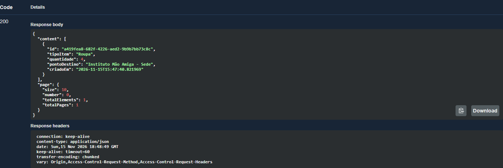

### GET /api/v1/doacoes/{id} — 200

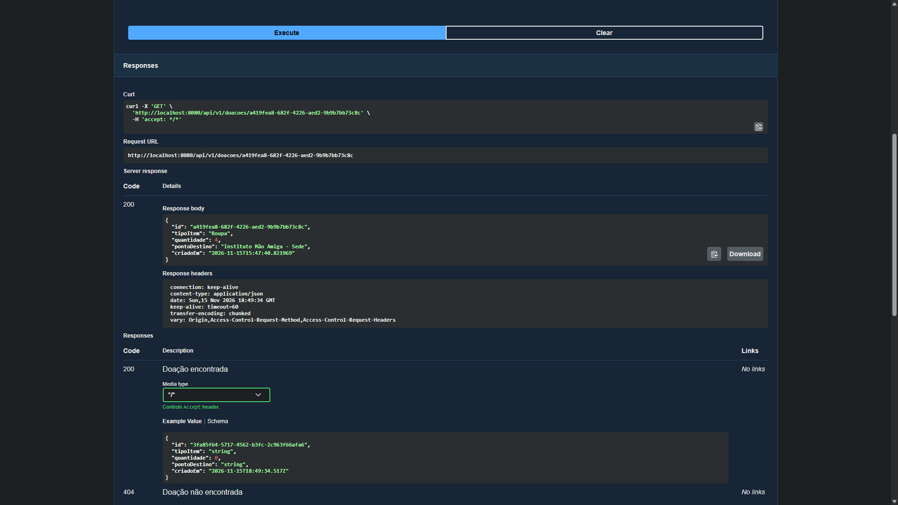

### GET /api/v1/doacoes/{id} — 404

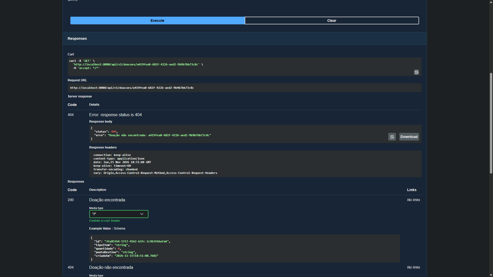

### POST /api/v1/doacoes — 201

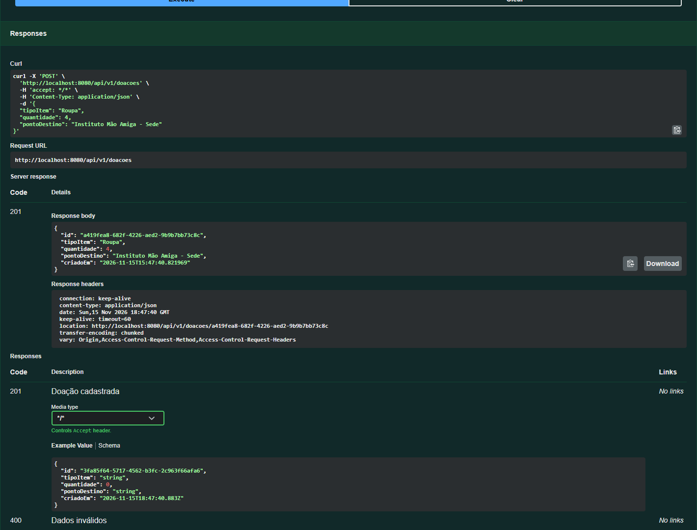

### POST /api/v1/doacoes — 400

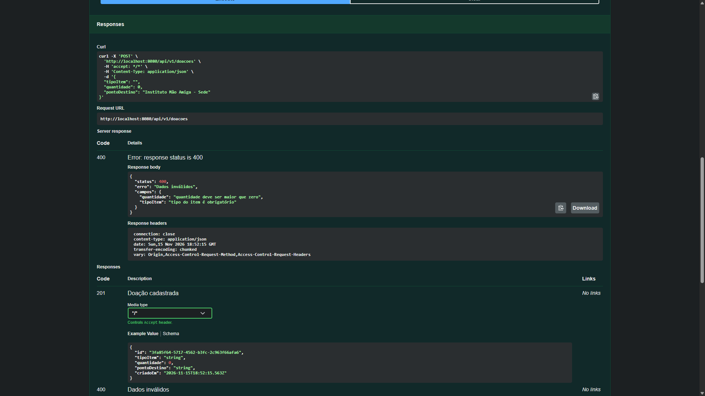

### PUT /api/v1/doacoes/{id} — 200

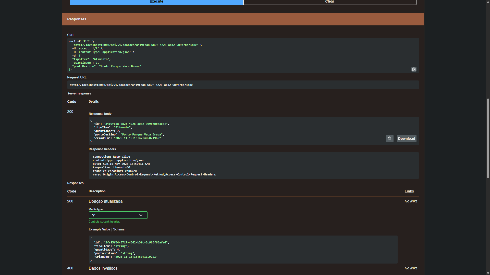

### PUT /api/v1/doacoes/{id} — 404

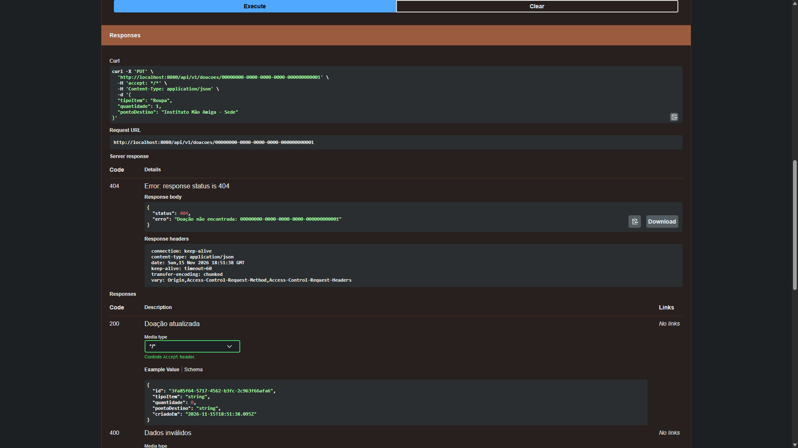

### DELETE /api/v1/doacoes/{id} — 204

A exclusão responde sem corpo.

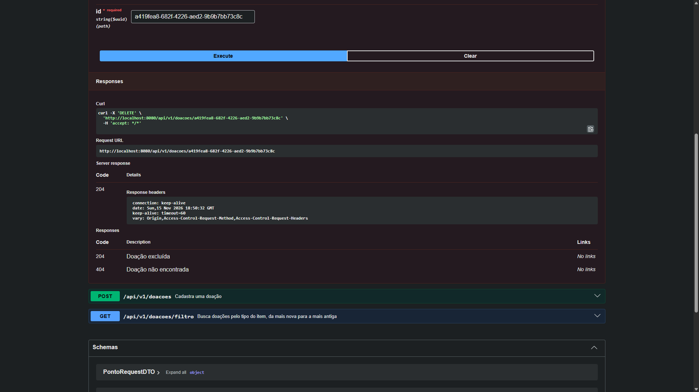
